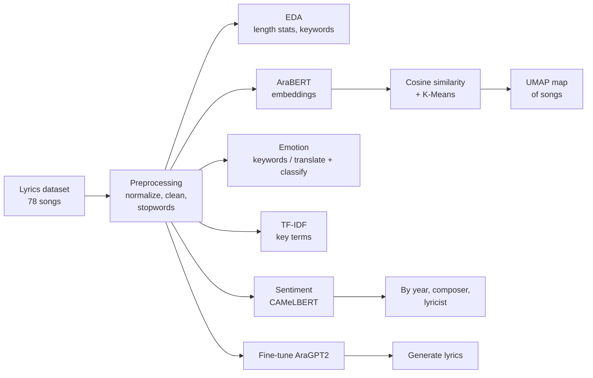

<div align="center">

# 🎵 Arabic Lyrics Analysis with LLMs

**Sentiment, emotion, theme, and similarity analysis of George Wassouf's discography using Arabic transformer models, plus a fine-tuned AraGPT2 lyric generator**

[](https://www.python.org/)
[](https://huggingface.co/)
[](https://pytorch.org/)
[](https://scikit-learn.org/)
[](https://plotly.com/)
[](https://jupyter.org/)

*Term project · Deep Learning · Faculty of Engineering, Alexandria University · 2025*

</div>

---

## 📖 Table of Contents

- [Overview](#-overview)
- [Key Features](#-key-features)
- [Models Used](#-models-used)
- [Pipeline](#-pipeline)
- [Results](#-results)
- [Lyric Generation with AraGPT2](#-lyric-generation-with-aragpt2)
- [Tech Stack](#-tech-stack)
- [Repository Structure](#-repository-structure)
- [Getting Started](#-getting-started)
- [Arabic NLP Challenges](#-arabic-nlp-challenges-addressed)
- [Limitations and Future Work](#-limitations-and-future-work)
- [Paper](#-paper)
- [Authors](#-authors)

---

## 🔍 Overview

George Wassouf's songs are known for emotionally rich lyrics about love, longing, and heartbreak. This project turns that impression into measurable data.

The dataset contains **78 songs** with **17 composers** and **34 lyricists** (track title, lyrics, release year, composer, lyricist). On top of it we build a complete Arabic NLP workflow: text cleaning and normalization, **sentiment analysis**, **emotion detection**, **TF-IDF** keyword extraction, **AraBERT song embeddings** with similarity search and **K-Means clustering**, composer/lyricist analysis, and an experimental **AraGPT2 model fine-tuned to generate lyrics** in his style.

---

## ✨ Key Features

- 🧹 **Arabic-aware preprocessing**: punctuation, newline and diacritic removal; normalization of letter variants (أ/آ/إ → ا, final ي → ى, final ة → ه); Arabic-only title extraction; NLTK Arabic stopword removal
- 📏 **Exploratory statistics**: lyric-length distribution (mean, median, mode), skew-normal fit, word counts per decade, keyword search across songs
- 😊 **Sentiment analysis** with a pretrained Arabic transformer (CAMeLBERT)
- 🎭 **Emotion detection**: a keyword-based baseline and a translate-then-classify approach with an English emotion model
- 🔑 **TF-IDF** over the whole catalogue and per composer
- 🧠 **AraBERT embeddings** of every song, with cosine-similarity search for the 5 most similar songs and K-Means clustering
- 🗺️ **UMAP** projection of the song space, with Arabic labels rendered correctly
- 🤝 **Composer and lyricist analysis**: average sentiment per person and per collaboration pair
- ✍️ **Lyric generation** with a fine-tuned AraGPT2

---

## 🤖 Models Used

| Task | Model / Method |
|---|---|
| Sentiment | [`CAMeL-Lab/bert-base-arabic-camelbert-da-sentiment`](https://huggingface.co/CAMeL-Lab/bert-base-arabic-camelbert-da-sentiment) (positive / neutral / negative) |
| Song embeddings | [`aubmindlab/bert-base-arabertv2`](https://huggingface.co/aubmindlab/bert-base-arabertv2) (768-dim) |
| Clustering | K-Means (k = 4) on the embeddings |
| Similarity | Cosine similarity (top 5 neighbours per song) |
| 2D visualization | UMAP |
| Emotion | Keyword rules, and `deep-translator` (Arabic → English) + [`j-hartmann/emotion-english-distilroberta-base`](https://huggingface.co/j-hartmann/emotion-english-distilroberta-base) |
| Keywords | TF-IDF (scikit-learn) |
| Lyric generation | [`aubmindlab/aragpt2-base`](https://huggingface.co/aubmindlab/aragpt2-base), fine-tuned on the lyrics |

---

## 🔄 Pipeline



---

## 📊 Results

### Sentiment distribution

The sentiment model classifies the catalogue as predominantly **negative**, matching the themes of heartbreak and separation.

<p align="center">
  
</p>

| Sentiment | Songs | Share |
|---|---:|---:|
| Negative | 51 | 65% |
| Positive | 16 | 21% |
| Neutral | 11 | 14% |

### Lyric length

After cleaning, a song has on average **~340 words** (median **294**, mode ≈ **231**). The distribution is right-skewed, with a few very long songs.

<p align="center">
  
</p>

### Recurring terms (TF-IDF)

The most prominent words are intimate and emotional: **قلبي** (my heart), **حبيبي** (my beloved), **الهوى** (passion), **الدنيا** (the world), **ليل** (night), **روحي** (my soul), **عيني** (my eyes). Dialect function words such as في, اللي and انا also rank high, because the NLTK Arabic stopword list targets Modern Standard Arabic rather than dialect.

<p align="center">
  
</p>

### Song map: embeddings, K-Means, and UMAP

Each song is embedded with AraBERT, grouped with K-Means (k = 4), and projected to 2D with UMAP. Nearby songs share vocabulary and style. `song_similarities.csv` lists the 5 most similar songs for each track.

<p align="center">
  
</p>

### Composers and lyricists

The notebook computes average sentiment per lyricist, per composer, and per lyricist–composer pair, together with trend plots and a pairwise heatmap. Most collaborators appear in only one or a few songs, so these figures are best treated as **exploratory** rather than as statistically conclusive.

---

## ✍️ Lyric Generation with AraGPT2

As an extension, `aubmindlab/aragpt2-base` is fine-tuned on the cleaned lyrics (318 training samples, trained on CPU) and used to continue a prompt:

```python
generate_lyrics("يا قلبي لا تحزن", max_length=200)
```

The model picks up the vocabulary and mood of the catalogue (heart, pain, love, separation), but with so little data the output is repetitive and not coherent. Treat it as a proof of concept, not a lyric writer. More data, a larger model, or parameter-efficient fine-tuning would be the next steps.

---

## 🧰 Tech Stack

| Area | Tools |
|---|---|
| **Language** | Python 3.12 |
| **NLP / LLMs** | Hugging Face Transformers, PyTorch, NLTK, `deep-translator` |
| **Machine learning** | scikit-learn (TF-IDF, K-Means, cosine similarity), UMAP, SciPy |
| **Data** | Pandas, NumPy |
| **Visualization** | Matplotlib, Seaborn, Plotly, `arabic-reshaper`, `python-bidi` |
| **Environment** | Jupyter Notebook |

---

## 📁 Repository Structure

```
Arabic-Lyrics-Analysis-LLM/
├── Term_Project.ipynb                        # Full analysis notebook
├── requirements.txt                          # Python dependencies
├── george_wassouf_lyrics_with_sentiment.csv  # Songs with sentiment and emotion labels
├── song_embeddings.csv                       # AraBERT embedding per song
├── song_similarities.csv                     # Top-5 most similar songs per track
├── song_clusters.csv                         # K-Means cluster per song
├── images/                                   # Figures used in this README
├── docs/                                     # Project paper (PDF)
└── Progress_Reports/                         # Course progress reports
```

---

## 🚀 Getting Started

### Prerequisites

- Python 3.10 or newer (developed on 3.12)
- Jupyter Notebook or JupyterLab
- Internet access on the first run, to download the Hugging Face models and NLTK stopwords
- A GPU is helpful for fine-tuning but not required for the analysis

### Installation

```bash
git clone https://github.com/YoussefMohAttia/Arabic-Lyrics-Analysis-LLM.git
cd Arabic-Lyrics-Analysis-LLM

pip install -r requirements.txt
python -c "import nltk; nltk.download('stopwords')"
```

### Run

```bash
jupyter notebook Term_Project.ipynb
```

Run the cells from top to bottom. The notebook reads the lyrics dataset and writes the intermediate CSV files listed above. The fine-tuning cells save the model to `./george_wassouf_aragpt2`, which the generation cells then load, so run them in order.

---

## 🔤 Arabic NLP Challenges Addressed

Arabic is hard for classic NLP pipelines because of its rich morphology, right-to-left script, optional diacritics, and wide dialect variation. This project handles them by:

- Removing diacritics and normalizing letter variants so one word is not split into several forms
- Using contextual transformer models instead of bag-of-words only
- Applying Arabic stopword filtering
- Reshaping and reordering Arabic labels in charts so they render right-to-left

---

## 🔭 Limitations and Future Work

- **Small, single-artist dataset** (78 songs), so findings describe this catalogue rather than Arabic music in general
- **Dialect:** the lyrics are in dialect, while the stopword list and some models are tuned for Modern Standard Arabic
- **Input length:** transformer models accept at most 512 tokens, and many songs are longer. Long lyrics must be truncated or split into chunks, which affects the emotion pipeline in particular
- **Emotion detection** through machine translation is experimental, since translation can lose the nuance of poetic dialect
- **Composer and lyricist statistics** rest on very few songs per person
- **Human validation** of the model labels is still needed
- **Next steps:** chunk long lyrics, evaluate against manually labelled songs, add more artists, and improve the generation model

---

## 📄 Paper

This work is described in **"Sentiment Analysis of Arabic Song Lyrics: A Case Study on George Wassouf's Discography"** (May 2025).

📎 [Read the paper](docs/George_Wassouf_Lyrics_Analysis_Paper.pdf)

---

## 👥 Authors

Department of Computer and Communication Engineering, Faculty of Engineering, Alexandria University.

| Name |
|---|
| Youssef Mohamed Attia |
| Mazen Elsayed |
| Yomna Gharib |
| Mohamed Morsy |

⭐ If you find this project useful, consider giving it a star!

</div>
